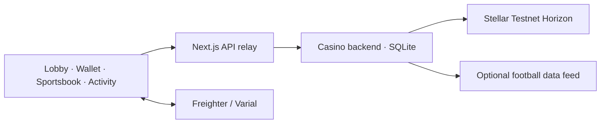

# RemitPulse Stellar Arcade

The Next.js frontend serves nine casino games and a simulated sportsbook. Every stake and return is shown in XLM. The wallet connects to Stellar Testnet through Freighter and displays its balance separately from demo credits.

## How the app fits together



| Screen | What it shows |
| --- | --- |
| Lobby | Nine casino games, game search, and favorites |
| Wallet | Demo credits, credited Testnet XLM, connected wallet balance, and transfer history |
| Sportsbook | Fixtures, quoted simulated odds, bet slip, and downloadable settled tickets |
| Activity | Player ledger, downloadable Dice receipts, and passkey account recovery |
| Operator | Treasury reconciliation, pending transfer recovery, and observed football score revisions |

## Start locally

Use Node.js 24. Start the sibling [backend](https://github.com/Remitpulse/backend/tree/stellar-casino-milestone) on port 4010, then run:

```sh
npm ci
npm run dev
```

Open `http://localhost:3000`. Set `CASINO_BACKEND_URL` for a different backend address. Set `CASINO_PUBLIC_ORIGIN` on both services to the exact public HTTPS origin when deploying behind a proxy. Use the same origin for passkey enrollment and sign-in.

| Frontend variable | Purpose |
| --- | --- |
| `CASINO_BACKEND_URL` | Backend relay target, defaults to `http://127.0.0.1:4010` |
| `CASINO_PUBLIC_ORIGIN` | Exact public origin for relay origin checks and matching backend passkeys |
| `CASINO_STANDALONE` | Set to `1` for a Next.js standalone build |

For wallet testing, open the site in a desktop browser with Freighter (Varial) installed and unlocked. Select Stellar Testnet, connect, and confirm that the address and network match the display before signing. Passkey enrollment and recovery use the same site origin.

## Games

| Game | How to play |
| --- | --- |
| Mines | Set 1–24 mines, reveal gems and cash out. The table shows the current return and the next gem’s potential return. |
| Dice | Set a threshold and see four tumbling dice show the exact server roll from 00.00 to 99.99. The track shows the cutoff and win chance. |
| Plinko | Watch the eight-step drop land in the server-selected multiplier slot. |
| Limbo | Set a target and compare it with the final multiplier. |
| Coin Flip | Choose heads or tails and watch the settled face turn into view. |
| European Roulette | Choose red, black or zero and watch the wheel settle on the actual pocket. |
| Keno | Choose five numbers and watch ten drawn numbers appear in order. |
| Wheel | Spin a twelve-segment wheel with six blank segments. |
| Baccarat | Back Player, Banker or Tie and see both hands dealt from the server result. |

Game tables show wager presets, exact XLM returns and the most recent settled outcomes available in your activity ledger. The sportsbook offers simulated fixtures by default. With the backend football provider configured, it displays real football fixtures alongside simulated basketball and tennis. The quoted odds and wagers are simulated.

## Verify and deploy

Run `npm run lint`, `npm run typecheck` and `npm run build`. For Playwright, start the backend, build the frontend, run `npx playwright install chromium`, then run `npm run test:e2e`. The [backend deployment instructions](https://github.com/Remitpulse/backend/tree/stellar-casino-milestone#deploy-both-services) cover the two-service Compose stack.

The deployed milestone uses simulated wagers and Stellar Testnet wallet payments. The operator can enable native Testnet transfers by configuring a funded Testnet treasury on the backend. See the [visual architecture](docs/casino-design.md).

### Resume a Testnet transfer

Open **Wallet** and connect Freighter on Stellar Testnet. The on-chain
balance belongs to the connected address. The credited Testnet balance is
available for withdrawal to the session's linked wallet.

When a deposit was signed before an interruption, **Resume signed deposit
from this browser** retries that exact envelope. Under **Recent Testnet
transfers**, **Check deposit** checks the selected transaction by its hash.
For a reserved withdrawal, **Check pending withdrawal** checks the hash shown
in the wallet. A definitive failed withdrawal returns its reserve and remains
visible in history.

### Verify a Dice round

Before a wager, expand **Pre-wager Dice proof** and save the commitment for
the next roll. The table can verify the receipt against the commitment it
received before play. Later, open **Activity → Dice proof** to compare a
saved commitment or download the receipt for offline verification.

### Review an expired transfer

If Horizon has no receipt and the signed envelope has expired, the wallet
shows that the transaction needs operator review. Use the transaction hash
from the wallet or Activity when investigating. A reserved withdrawal
remains in the pending queue until there is a recorded outcome.

### Football fixtures and ticket receipts

When the backend has a football data provider token, the sportsbook displays
real football fixtures with simulated odds and stakes. Tickets use regulation
time, including stoppage time. A changed kickoff or quoted price requires a new
selection. The fixture list displays a separate notice during a feed outage.

Open **Your tickets** to review the settlement and download its receipt.
Provider score corrections are shown with the time they were observed.
The contracts checkout can verify the payout offline and compare the ticket
with the provider's current result.

When TheSportsDB is enabled, the sportsbook shows pre-match XLM demo markets
on supported upcoming fixtures. The schedule rolls over daily in UTC. Kickoff
times appear in your local timezone, and teams display provider badges or
initials. Demo odds are fixed at placement and tickets settle using the
provider's recorded final score. Provider coverage varies by plan.
